# CoinPlus — Full-Stack API Integration Architecture

This document describes the architectural integration between the React/TypeScript frontend (`CoinPlus`) and the Laravel 11 REST API backend (`Coins_api_v2`).

---

## 1. Architectural Overview

```mermaid
graph LR
    subgraph Frontend [CoinPlus React 18 SPA]
        UI[Pages & Modals] --> Services[Domain Services]
        Services --> Client[apiClient Axios Instance]
        Client -- Injects Bearer Token --> Interceptor[Request Interceptor]
    end

    subgraph Backend [Coins_api_v2 Laravel 11]
        Cors[CORS Middleware] --> Sanctum[Sanctum Authenticate]
        Sanctum --> RateLimit[Throttle Middleware]
        RateLimit --> Controllers[Api Controllers]
        Controllers --> Eloquent[Eloquent Models & DB Transactions]
        Eloquent --> MySQL[(MariaDB / MySQL coinplus)]
    end

    Interceptor -- HTTP/JSON with Credentials --> Cors
```

---

## 2. Centralized Frontend Service Layer

The frontend integration layer is located in `CoinPlus/src/services/`:

- **`apiClient.ts`**: Centralized Axios client.
  - Base URL resolved from `import.meta.env.VITE_API_BASE_URL || 'http://127.0.0.1:8000/api'`.
  - Automatic Bearer token extraction from `localStorage` or `sessionStorage` and injection into the `Authorization` request header.
  - Global response error interceptor handling session expiration (401), invalid credentials (422), and forbidden access (403).
- **`authService.ts`**: Client and administrator login, registration, logout, and token lifecycle management.
- **`marketService.ts`**: Live market ticker data, order book depth, recent trades, and OHLCV candlestick series.
- **`tradeService.ts`**: Order placement (limit and market orders), order book cancellation, and open/history queries.
- **`walletService.ts`**: Aggregated portfolio balances, individual asset allocations, transaction ledger, and deposit/withdrawal workflows.
- **`accountService.ts`**: User profile parameters, password updates, 2FA status, and session tracking.
- **`adminService.ts`**: Administrative KPI metrics, user management, KYC review pipeline, deposit/withdrawal reviews, and system settings.

---

## 3. End-to-End Verified Workflows

The following user flows have been wired and verified against the live backend:
1. **Customer Authentication:**
   - User enters credentials on `Login.tsx` (`demo.trader@coinplus.io` / `CoinPlus2026!#`).
   - `authService.login()` dispatches `POST /api/auth/login`.
   - Backend validates password hash using Bcrypt, generates a Sanctum personal access token, and returns the user model.
   - Frontend stores token in `localStorage` and redirects to `/dashboard`.
2. **Portfolio Data Synchronization:**
   - `Dashboard.tsx` and `Assets.tsx` execute `walletService.getSummary()` and `walletService.getAssets()`.
   - Backend computes live available and locked balances across all 8 cryptocurrencies in MySQL.
   - Frontend updates total balance, percentage allocations, and 24h PnL dynamically.
3. **Spot Trading & Order Execution:**
   - User configures order in `OrderForm.tsx` and clicks Confirm in `OrderConfirmationModal.tsx`.
   - `tradeService.placeOrder()` submits `POST /api/trade/orders`.
   - Laravel executes an atomic database transaction (`DB::transaction`):
     - Validates available quote/base currency balance.
     - Deducts available balance and locks funds (for limit orders) or executes immediate fill (for market orders).
     - Records spot transaction in `transactions` ledger.
   - Frontend adds order to active orders and displays real-time toast notification.
4. **Order Cancellation:**
   - User clicks Cancel on an open order in `Orders.tsx` or `BottomOrdersPanel.tsx`.
   - `tradeService.cancelOrder()` submits `POST /api/trade/orders/{id}/cancel`.
   - Backend verifies authenticated user ownership, releases locked funds back to available balance, and marks status as `cancelled`.
5. **Operator Administration Access:**
   - Operator signs in on `AdminLogin.tsx` (`operator@coinplus.io` / `SuperAdmin2026!#`).
   - Dispatches `POST /api/auth/admin-login`.
   - Backend verifies operator credentials and `role === 'admin'`.
   - Operator accesses protected `/admin/*` routes with full audit logging.
